# Figma Changelog

**Every time your Figma file gets a new version, your team gets a short, readable summary of what changed — with before/after pictures — in Google Chat, Slack and/or Telegram.**

Runs for free on GitHub Actions. No server, no paid services, no npm dependencies.

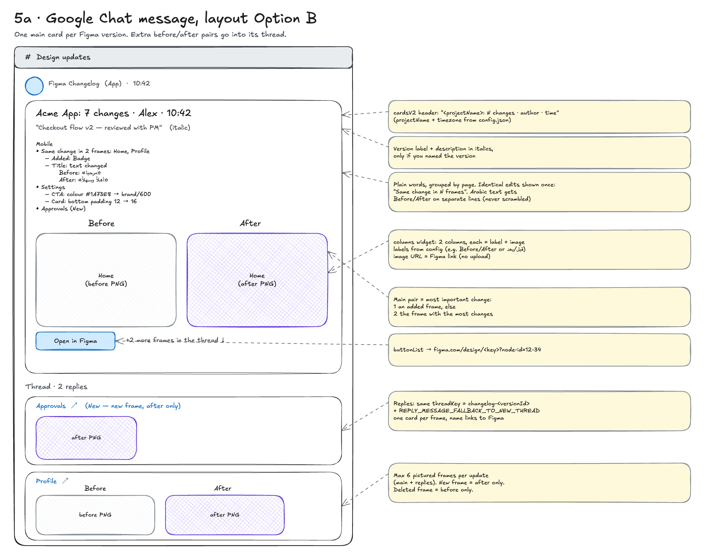

---

## Contents

1. [What it does](#what-it-does)
2. [How it works](#how-it-works)
3. [Setup in 5 steps](#setup-in-5-steps)
4. [Configuration](#configuration)
5. [Secrets](#secrets)
6. [Commands](#commands)
7. [Messages in each channel](#messages-in-each-channel)
8. [What counts as a change](#what-counts-as-a-change)
9. [Colour token names](#colour-token-names)
10. [Schedule and timing](#schedule-and-timing)
11. [Pause, resume, change](#pause-resume-change)
12. [Cost](#cost)
13. [Troubleshooting](#troubleshooting)
14. [Project structure](#project-structure)
15. [Development](#development)
16. [Limitations](#limitations)
17. [All diagrams](#all-diagrams)
18. [License](#license)

---

## What it does

Every hour, it checks your Figma file's **version history**. For each new version it:

1. **Compares** it with the version before, on the pages you choose.
2. **Writes a plain-language summary**, grouped by page and frame:
   - frames added, deleted, renamed or moved
   - text changes (old and new text; Arabic and other right-to-left text stays readable)
   - colour and border changes (token name if known, otherwise hex)
   - size, spacing, padding and corner radius changes
   - component swaps and variant changes (`State: Default → Hover`)
   - layers added, removed, shown or hidden
3. **Takes before/after pictures** of the most important frames (up to 6) straight from Figma.
4. **Posts** one message per version to every channel you connected.
5. **Keeps a permanent history** in `CHANGELOG.md`, with copies of the pictures in `changelog-images/` (Figma's own picture links expire after ~30 days).

A message looks like this:

```text
Acme App: 7 changes · Alex · Wed 11 Nov, 10:42
“Checkout flow v2 — reviewed with PM”

Mobile
• Same change in 2 frames: Home, Profile
    – Added: Badge
    – Title: text changed
          Before: «مرحبا»
          After:  «أهلاً وسهلاً»
• Settings
    – CTA: colour #1A73E8 → brand/600
    – Card: bottom padding 12 → 16
• Approvals (New)

[ Before ]  [ After ]      ← pictures of the main frame
[ Open in Figma ]
+2 more frames in the thread
```

Versions with no meaningful change (only moving the viewport, selecting things, prototype settings, tiny rounding differences) are skipped silently.

---

## How it works

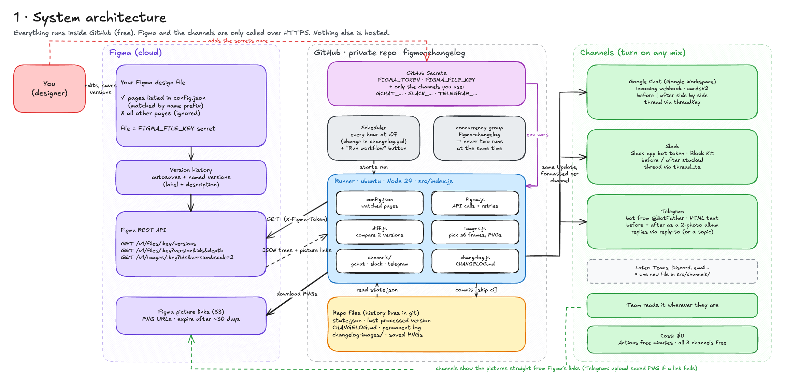

- **GitHub Actions** starts the script every hour (and whenever you click **Run workflow**).
- The script reads your file through the **Figma REST API** with a personal access token.
- It compares versions **by layer ID**, so a renamed or moved layer is still recognised as the same layer.
- Pictures are rendered by Figma; channels load them straight from Figma's links (nothing is uploaded elsewhere).
- Progress is stored **in the repo itself** (`state.json`): each channel remembers the last version it received. If one channel fails, the others carry on and the failed one catches up on the next run. Nothing is ever posted twice.

<details>
<summary><b>Run flow</b> — what one run does, step by step</summary>

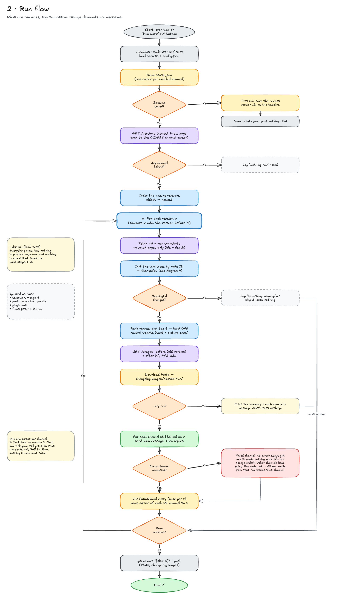

</details>

<details>
<summary><b>Sequence</b> — the exact API calls, in order</summary>

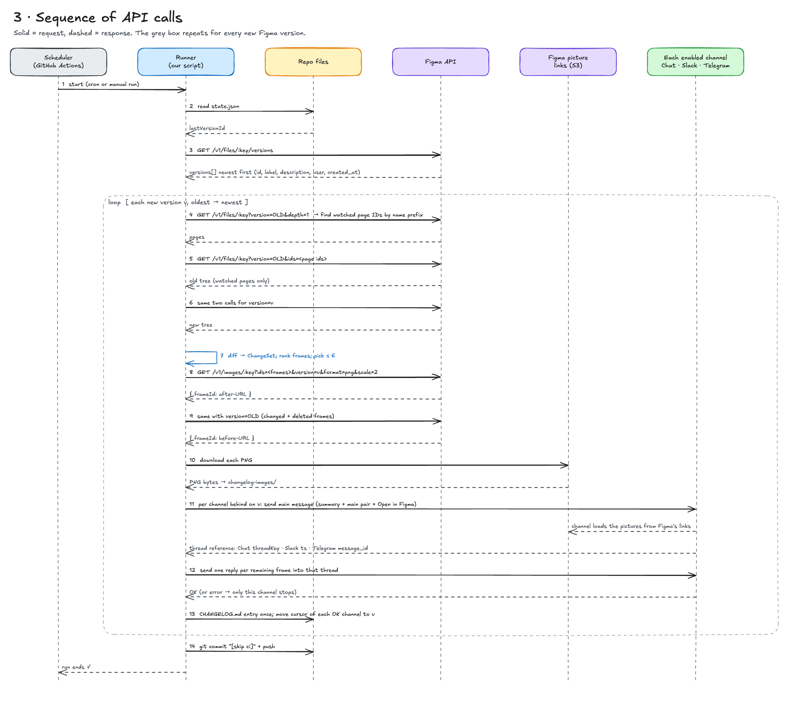

</details>

---

## Setup in 5 steps

About 20 minutes. You need a GitHub account, a Figma **Full or Dev seat on a paid plan**, and Node.js 20 or newer on your computer for testing.

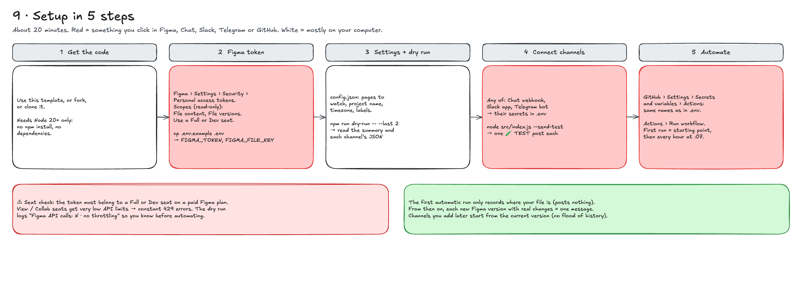

### 1. Get the code

Click **Use this template** (or fork / clone this repo) to get your own copy. Keep your copy **private** if your designs are confidential: `CHANGELOG.md` and the pictures will contain them.

```bash
git clone https://github.com/<you>/figma-changelog.git
cd figma-changelog
npm test          # optional: runs the self-tests, needs no secrets
```

There is nothing to install: Node 20+ has everything built in.

### 2. Create a Figma token

1. In Figma: your avatar › **Settings** › **Security** › **Personal access tokens** › **Generate new token**.
2. Name it `figma-changelog`. Pick the longest expiration offered (you'll renew it when it expires).
3. Scopes, all **read-only**: **File content** and **File versions**. Everything else: no access.
4. Copy the token (Figma shows it only once).

> The token must belong to a **Full or Dev seat**. View/Collab seats have very low API limits and get blocked (HTTP 429).

Put it in a local `.env` file (never committed):

```bash
cp .env.example .env
open -e .env      # macOS; or open it in any text editor
```

```ini
FIGMA_TOKEN=figd_xxxxxxxxxxxxxxxxxxxxxxxxxxxxxxxx
FIGMA_FILE_KEY=https://www.figma.com/design/AbCdEfGhIjKlMnOpQrStUv/My-File
```

`FIGMA_FILE_KEY` can be the whole file link or just the key after `/design/`.

### 3. Choose what to watch, then do a dry run

Edit [`config.json`](config.json) — at least `watchedPagePrefixes` and `timezone` (see [Configuration](#configuration)). Then:

```bash
npm run dry-run -- --last 2
```

This compares your 2 newest versions and prints the summary plus exactly what each channel would receive. **Nothing is posted or saved.** Pictures and payloads land in `.dry-run/` (git-ignored). The last line tells you if Figma throttled you:

```text
Figma API calls: 12 · no throttling
```

### 4. Connect your channels

Connect any mix; a channel is **on** when its secrets are set and **off** otherwise.

<details open>
<summary><b>Google Chat</b> (Google Workspace) — ~2 min</summary>

1. Open the space for the updates › click the **space name** › **Apps & integrations** › **Webhooks** (or **Manage webhooks**).
2. **Add webhook**, name it `Figma Changelog`, **Save**, copy the URL.
3. In `.env`: `GCHAT_WEBHOOK_URL=<the URL>`

If there is no Webhooks option, your Workspace admin has disabled incoming webhooks.
</details>

<details>
<summary><b>Slack</b> — ~5 min</summary>

1. **api.slack.com/apps** › **Create New App** › **From scratch**: name `Figma Changelog`, pick your workspace.
2. **OAuth & Permissions** › **Bot Token Scopes** › add **`chat:write`**.
3. **Install to Workspace** › **Allow**. Copy the **Bot User OAuth Token** (`xoxb-…`).
4. In the Slack channel: `/invite @Figma Changelog`.
5. Click the channel name › copy the **Channel ID** (`C…`) at the bottom.
6. In `.env`: `SLACK_BOT_TOKEN=xoxb-…` and `SLACK_CHANNEL_ID=C…`

Simpler alternative without threads: create an incoming webhook and set only `SLACK_WEBHOOK_URL` (all pictures then go into one message).
</details>

<details>
<summary><b>Telegram</b> — ~3 min</summary>

1. Talk to **@BotFather** › `/newbot` › choose a name and a username ending in `bot`. Copy the token.
2. In `.env`: `TELEGRAM_BOT_TOKEN=<token>`
3. Add the bot to your group and send any message there (e.g. "hi").
4. Find the group's ID:
   ```bash
   node src/index.js --telegram-chat-id
   ```
5. In `.env`: `TELEGRAM_CHAT_ID=-100…`  (for forum groups, optionally `TELEGRAM_TOPIC_ID`)
</details>

Then send **one real test message** to each connected channel (marked 🧪 TEST, nothing is saved):

```bash
node src/index.js --send-test
node src/index.js --send-test --only slack     # just one channel
```

### 5. Automate on GitHub

1. In your repo: **Settings** › **Secrets and variables** › **Actions** › **New repository secret**. Add the same names and values as in your `.env` — only the ones you use:

   | Required | Optional (per channel) |
   |---|---|
   | `FIGMA_TOKEN`, `FIGMA_FILE_KEY` | `GCHAT_WEBHOOK_URL` · `SLACK_BOT_TOKEN` + `SLACK_CHANNEL_ID` (or `SLACK_WEBHOOK_URL`) · `TELEGRAM_BOT_TOKEN` + `TELEGRAM_CHAT_ID` (+ `TELEGRAM_TOPIC_ID`) |

   Paste only the value (what comes after `=`). Stray spaces, quotes or a pasted `NAME=` are cleaned up automatically.

2. **Actions** tab › **Figma changelog** › **Run workflow** › **Run workflow**.

The **first run only records where your file is** and posts nothing. From then on, every new version with real changes becomes one message. To see a real post right away, save a version in Figma (**⌘⌥S** / **Ctrl+Alt+S**) after the first run and click **Run workflow** again.

> Until `FIGMA_TOKEN` and `FIGMA_FILE_KEY` exist as secrets, scheduled runs skip quietly with a notice instead of failing.

---

## Configuration

All settings live in [`config.json`](config.json):

```json
{
  "projectName": "",
  "watchedPagePrefixes": ["Mobile", "Web"],
  "maxPicturesPerUpdate": 6,
  "imageScale": 2,
  "maxLinesPerFrame": 8,
  "timezone": "UTC",
  "labels": { "before": "Before", "after": "After", "new": "New", "deleted": "Deleted", "openInFigma": "Open in Figma" },
  "channels": {
    "gchat": { "enabled": true },
    "slack": { "enabled": true, "threads": true },
    "telegram": { "enabled": true }
  }
}
```

| Setting | What it does | Default |
|---|---|---|
| `projectName` | Name in the message header. Empty = the Figma file's name. | `""` |
| `watchedPagePrefixes` | Pages to watch, matched by the **start** of the page name. Emoji, extra spaces and upper/lower case don't matter. Empty list = all pages. | `[]` (all) |
| `maxPicturesPerUpdate` | Frames that get before/after pictures per version. The rest are listed as "+N more". | `6` |
| `imageScale` | Picture resolution (1–4). | `2` |
| `maxLinesPerFrame` | Change lines per frame before "…and N more". | `8` |
| `timezone` | Times in messages, e.g. `Europe/London`, `Africa/Cairo`, `Asia/Dubai`. | `UTC` |
| `labels` | Words used in messages — translate them, e.g. `"before": "قبل", "after": "بعد", "new": "جديد"`. | English |
| `channels.<name>.enabled` | `false` switches a channel off even if its secrets exist. | `true` |
| `channels.slack.threads` | Slack: extra frames as thread replies (bot mode) or all in one message. | `true` |
| `maxVersionsPerRun` | (optional) Versions handled per run when many piled up. | `20` |

Changing `config.json` on GitHub (edit the file in the browser and commit) takes effect on the next run.

---

## Secrets

| Name | Needed for | Where it comes from |
|---|---|---|
| `FIGMA_TOKEN` | always | Figma › Settings › Security › Personal access tokens |
| `FIGMA_FILE_KEY` | always | Your file link, or the part after `/design/` |
| `GCHAT_WEBHOOK_URL` | Google Chat | Space › Apps & integrations › Webhooks |
| `SLACK_BOT_TOKEN` + `SLACK_CHANNEL_ID` | Slack (with threads) | Your Slack app + channel details |
| `SLACK_WEBHOOK_URL` | Slack (no threads) | Slack incoming webhook |
| `TELEGRAM_BOT_TOKEN` + `TELEGRAM_CHAT_ID` | Telegram | @BotFather + `--telegram-chat-id` |
| `TELEGRAM_TOPIC_ID` | Telegram forum topics | Optional |

Locally they go in `.env` (git-ignored); on GitHub in **Settings › Secrets and variables › Actions**. Secret values are never printed in logs — if one looks wrong, the log describes its *shape* (length, quotes, spaces) instead.

---

## Commands

| Command | What it does |
|---|---|
| `npm run dry-run` | Newest version vs the one before: summary + each channel's payload. Posts and saves nothing. |
| `npm run dry-run -- --last 3` | Same for the 3 newest versions. |
| `node src/index.js --dry-run --versions OLD,NEW` | Compare two specific version IDs. |
| `node src/index.js --send-test` | Post the newest version once, marked 🧪 TEST, to every connected channel. Saves nothing. |
| `node src/index.js --send-test --only gchat` | …to one channel (`gchat`, `slack`, `telegram`). |
| `node src/index.js --telegram-chat-id` | List the Telegram groups your bot is in, with their IDs. |
| `node src/index.js` | A normal run (what GitHub Actions does). |
| `npm test` | Self-tests with fake Figma/Chat/Slack/Telegram servers. |

---

## Messages in each channel

The same summary, adapted to what each app can do.

| | Google Chat | Slack | Telegram |
|---|---|---|---|
| Format | Card | Block Kit | HTML text + photo albums |
| Before / after | side by side | stacked | 2-photo album |
| Extra frames | thread replies | thread replies | replies to the summary |
| Button | Open in Figma | Open in Figma | Open in Figma |

<details>
<summary><b>Google Chat</b> layout</summary>


</details>

<details>
<summary><b>Slack</b> layout</summary>

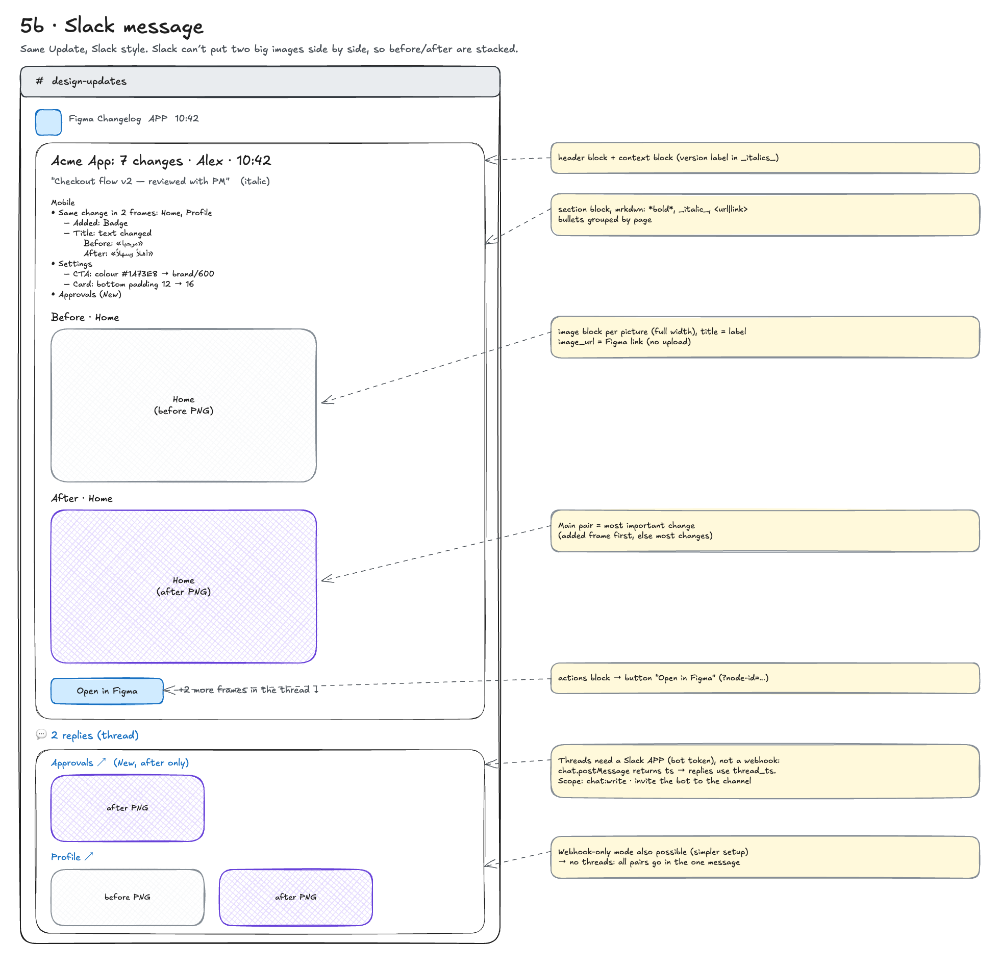
</details>

<details>
<summary><b>Telegram</b> layout</summary>

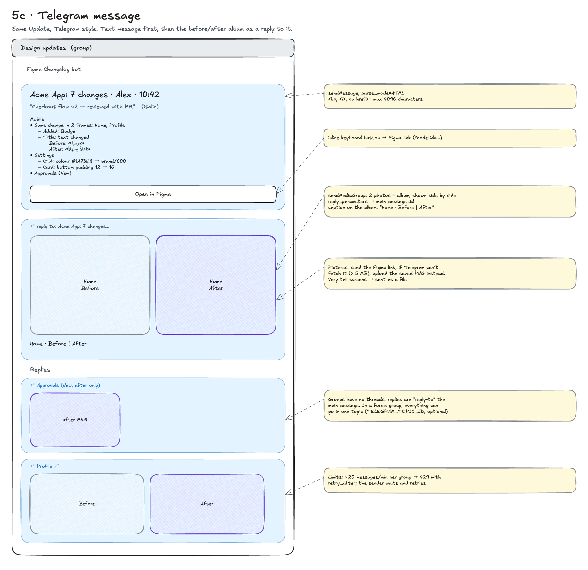
</details>

<details>
<summary><b>Channel comparison</b> and how to add another channel</summary>

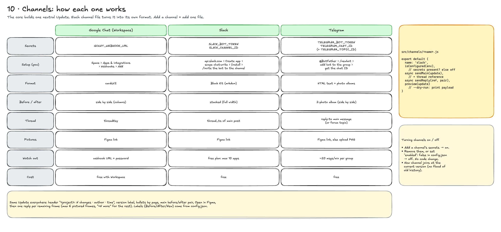

Adding a channel (Teams, Discord, email…) = one new file in `src/channels/` with `isConfigured`, `preview` and `send`, registered in `src/index.js`.
</details>

---

## What counts as a change

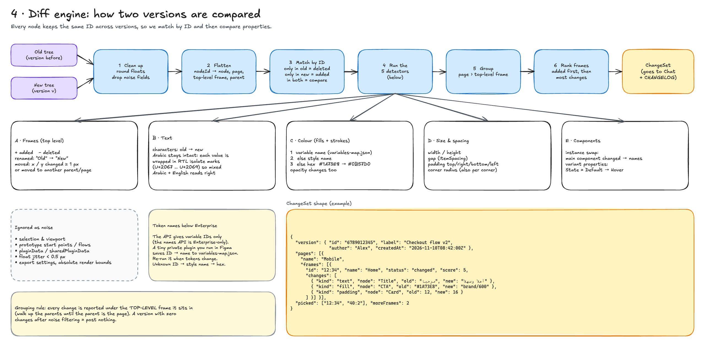

| Reported | Ignored |
|---|---|
| Top-level frames added / deleted / renamed / moved (frames inside sections count as top-level) | Selection, viewport, zoom |
| Text content (Before / After on separate lines for right-to-left or long text) | Prototype connections and start points |
| Fill and border colours (token name → style name → hex) | Plugin data, export settings |
| Width / height when fixed (not "hug" or "fill") | Size changes caused only by content growing |
| Spacing between items, padding per side, corner radius, auto-layout direction | Differences under 0.5 px |
| Component swaps and variant properties | Layers generated inside component instances |
| Layers added / removed / shown / hidden | |

To keep messages short: identical edits in several frames are shown once ("Same change in 4 frames: …"), identical edits on several layers are merged, and several tiny 1–4 letter text edits (initials, counters) fold into one line.

---

## Colour token names

Figma's API returns variable **IDs**, not names, unless you are on an Enterprise plan. So that messages can say `brand/600` instead of `#1A73E8`, a tiny private plugin exports the names:

1. Figma desktop › **Plugins** › **Development** › **Import plugin from manifest…** › pick `figma-plugin/manifest.json`.
2. Open your design file › **Plugins** › **Development** › **Changelog token names**.
3. Click **Copy** and paste everything into [`variables-map.json`](variables-map.json); commit it.
4. Run it again whenever you add or rename tokens.

Unknown variables fall back to the style name, then hex. The plugin has no network access.

---

## Schedule and timing

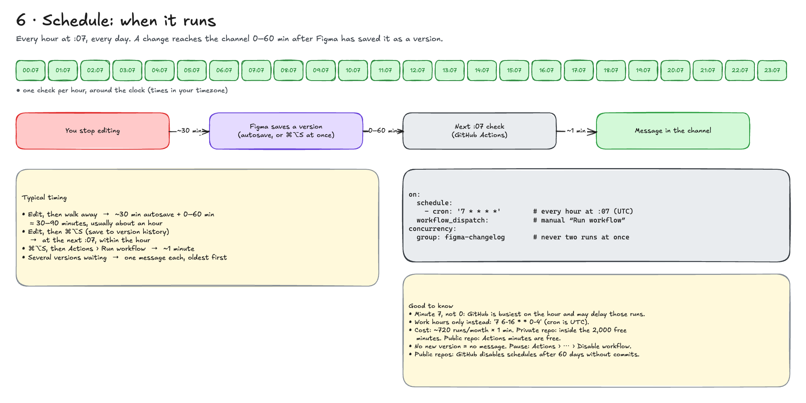

The workflow is scheduled **every hour at :07, every day** (minute 7 because GitHub is busiest on the hour). GitHub may start it late or skip an hour; see [Make it run on time](#make-it-run-on-time-optional-recommended).

How long until a message appears depends on when Figma creates a version:

| You… | Message appears |
|---|---|
| Edit, then walk away | Figma autosaves a version after you stop (about 30 min), then the next :07 check — usually ~1 hour in total |
| Edit, then **⌘⌥S** (save to version history) | At the next :07 |
| **⌘⌥S**, then **Run workflow** | ~1 minute |

If several versions piled up, each one gets its own message, oldest first. Named versions show their name and description in italics.

### Make it run on time (optional, recommended)

GitHub's schedule is **best effort**: runs can start late or be skipped, and a new repo may get no scheduled runs at all for hours. Nothing is lost when that happens (the next run posts every version it missed), but messages arrive late.

For runs that start on time, let the free service [cron-job.org](https://cron-job.org) start the workflow every hour. GitHub runs those requests right away. Keep the GitHub schedule as a backup: two runs never overlap, and a second run just finds nothing new.

**1. Create a GitHub token that can only start this workflow**

1. Open [github.com/settings/personal-access-tokens/new](https://github.com/settings/personal-access-tokens/new).
2. **Token name:** `figma-changelog trigger`.
3. **Expiration:** pick a fixed option such as **90 days** or **1 year** and note the date.
   > If **Generate token** does nothing when you click it, the expiration is the cause: choosing **No expiration** can leave a hidden empty date field that blocks the form. Pick a fixed option instead.
4. **Repository access:** **Only select repositories** → your copy of this repo.
5. **Permissions › Repository permissions › Actions:** **Read and write**. Leave everything else as it is.
6. **Generate token** and copy it with the copy button (GitHub shows it only once). Don't paste it anywhere but cron-job.org.

To check the token, run this in Terminal (it asks for the token without showing it; `200` means it works, `401` means it's wrong):

```bash
printf "Paste token: "; read -rs T; echo; curl -s -o /dev/null -w "%{http_code}\n" -H "Authorization: Bearer $T" https://api.github.com/repos/YOUR_USERNAME/YOUR_REPO/actions/workflows; unset T
```

**2. Create the cron job**

On cron-job.org, **Create cronjob**:

| Field | Value |
|---|---|
| **URL** | `https://api.github.com/repos/YOUR_USERNAME/YOUR_REPO/actions/workflows/changelog.yml/dispatches` |
| **Execution schedule** | Every 1 hour (any minute works) |
| **Advanced › Request method** | `POST` |
| **Advanced › Headers** | `Authorization` = `Bearer ` + your token (one space after `Bearer`)<br>`Accept` = `application/vnd.github+json`<br>`User-Agent` = `figma-changelog-cron` |
| **Advanced › Request body** | `{"ref":"main"}` |

Save, then **Test run**. `204 No Content` means it worked, and a new run appears in your Actions tab within seconds, shown as **Manually run by** you.

| Test run shows | Fix |
|---|---|
| `401 Unauthorized` | Token wrong or not pasted fully; check the `Bearer ` prefix, or regenerate the token |
| `403 Forbidden` | Token lacks **Actions: Read and write**, or doesn't include this repo |
| `404 Not Found` | Check `YOUR_USERNAME`, `YOUR_REPO` and the file name `changelog.yml` in the URL |
| `422 Unprocessable Entity` | Body must be exactly `{"ref":"main"}` (or your default branch name) |

When the token expires, runs from cron-job.org stop with `401`. Regenerate the token and paste the new one into the `Authorization` header.

---

## Pause, resume, change

| To… | Do this |
|---|---|
| **Pause** | Actions › **Figma changelog** › **⋯** › **Disable workflow** |
| **Resume** | Same place › **Enable workflow** (nothing is lost; it catches up) |
| **Run now** | Actions › **Figma changelog** › **Run workflow** |
| **Work hours only** | In `.github/workflows/changelog.yml` change `cron: '7 * * * *'` to e.g. `'7 6-16 * * 0-4'` (cron is in **UTC**; that example is 08–18 at UTC+2, Sunday–Thursday) |
| **Watch other pages** | Edit `watchedPagePrefixes` in `config.json` |
| **Switch a channel off** | Delete its secrets, or set `"enabled": false` in `config.json` |
| **Renew the Figma token** | Create a new token (step 2) and replace the `FIGMA_TOKEN` secret |

> On **public** repos GitHub disables scheduled workflows after 60 days without commits. Re-enable it in the Actions tab. Runs started by [cron-job.org](#make-it-run-on-time-optional-recommended) keep working either way.

---

## Cost

**$0.** Each run takes under a minute; GitHub counts it as 1 minute.

| Repo | Usage | Free allowance |
|---|---|---|
| Private | ~720 min/month (24 × 30) | 2,000 min/month on GitHub Free, shared by all your private repos |
| Public | — | Actions minutes are free |

If a private repo ever runs out, runs simply pause until next month (GitHub doesn't charge unless you set a spending budget). Usage: GitHub › Settings › **Billing and licensing** › **Usage**.

---

## Troubleshooting

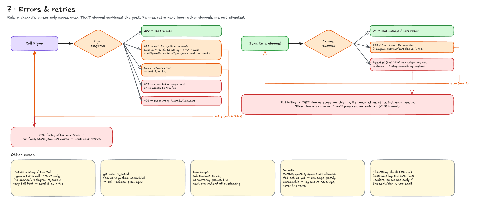

The run log (Actions › click a run › **Check Figma and post updates**) says what happened in plain words.

| You see | Meaning | Fix |
|---|---|---|
| `Not set up yet: add the FIGMA_TOKEN and FIGMA_FILE_KEY secrets` | Secrets missing | Add them ([step 5](#5-automate-on-github)) |
| `Figma …: HTTP 401 Invalid token` | Token wrong, expired or revoked | Create a new token, replace `FIGMA_TOKEN` |
| `HTTP 403` | Token lacks a scope or can't open the file | Scopes: File content + File versions; token owner must have access to the file |
| `HTTP 404` | Wrong file key | Check `FIGMA_FILE_KEY` |
| `THROTTLED (429)` / `limit type: low` | Token from a View/Collab seat, or too many calls | Use a token from a Full or Dev seat |
| `No page matches watchedPagePrefixes. Pages in this file: …` | Page names don't match | Copy a name from that list into `config.json` |
| `Channel X: off (no secrets)` | That channel isn't connected | Expected if you don't use it |
| `✗ Slack failed: channel_not_found` / `not_in_channel` | Bot not in the channel | `/invite @Figma Changelog` in the channel |
| `✗ Google Chat …: HTTP 400` | Card rejected | Open an issue with the log; other channels still post |
| Red run, other channels still posted | One channel failed | It retries from the same version next hour; nothing is lost or doubled |
| `Nothing new since the last run.` | No new Figma version | Save a version (⌘⌥S) |
| No scheduled runs, or runs hours late | GitHub's schedule is best effort | Disable and re-enable the workflow, or [use cron-job.org](#make-it-run-on-time-optional-recommended) |

---

## Project structure

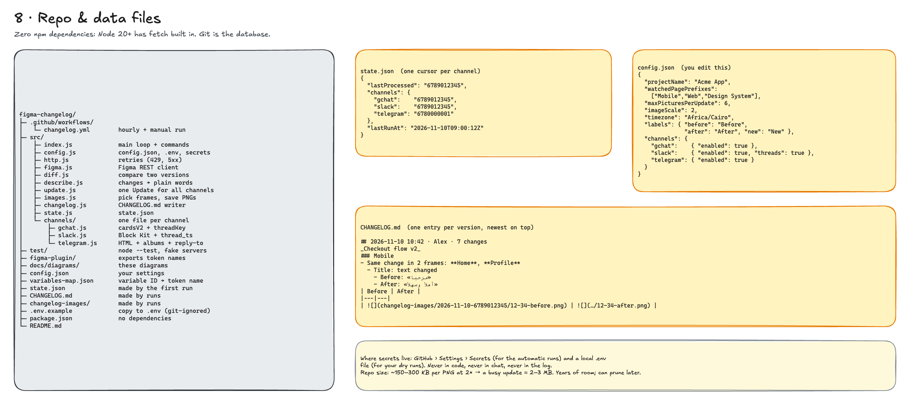

```text
.github/workflows/changelog.yml   hourly + manual run
src/index.js                      main loop and commands
src/figma.js                      Figma REST client (retries, rate limits)
src/diff.js                       compares two versions by layer ID
src/describe.js                   turns changes into plain words
src/update.js                     builds one neutral update for all channels
src/images.js                     picks frames, downloads before/after PNGs
src/changelog.js                  writes CHANGELOG.md
src/channels/                     gchat.js, slack.js, telegram.js
figma-plugin/                     exports colour token names
test/                             node --test with fake servers
docs/diagrams/                    the diagrams in this README + .excalidraw source
config.json                       your settings
state.json, CHANGELOG.md, changelog-images/   written by the runs
```

---

## Development

```bash
npm test                           # 30+ tests, no network, no secrets
npm run dry-run -- --last 2        # real Figma data, posts nothing
```

- Node 20+ with **no dependencies** (built-in `fetch`, `FormData`, `node:test`).
- Every Figma call retries on 429 (honouring `Retry-After`) and on 5xx/network errors.
- Channels are independent: each keeps its own cursor in `state.json`.

---

## Limitations

- Only **versions** are compared, not live edits — a change appears after Figma saves a version.
- Variable names need the plugin (or an Enterprise plan); otherwise colours show as hex or style names.
- Very large files: pages are fetched whole; keep `watchedPagePrefixes` focused if runs get slow.
- Google Chat incoming webhooks require Google Workspace and may be disabled by an admin.
- Figma picture links in old messages stop loading after ~30 days; `CHANGELOG.md` keeps copies.

---

## All diagrams

Source: [`docs/diagrams/figma-changelog.excalidraw`](docs/diagrams/figma-changelog.excalidraw) — open it at [excalidraw.com](https://excalidraw.com) (Menu › Open) to edit.

| | |
|---|---|
| [Overview & legend](docs/diagrams/00-overview.png) | [System architecture](docs/diagrams/01-architecture.png) |
| [Run flow](docs/diagrams/02-run-flow.png) | [Sequence of API calls](docs/diagrams/03-sequence.png) |
| [Diff engine](docs/diagrams/04-diff-engine.png) | [Google Chat message](docs/diagrams/05a-google-chat.png) |
| [Slack message](docs/diagrams/05b-slack.png) | [Telegram message](docs/diagrams/05c-telegram.png) |
| [Schedule](docs/diagrams/06-schedule.png) | [Errors & retries](docs/diagrams/07-errors.png) |
| [Repo & data files](docs/diagrams/08-repo-files.png) | [Setup in 5 steps](docs/diagrams/09-setup.png) |
| [Channels](docs/diagrams/10-channels.png) | |

---

## License

[MIT](LICENSE) — free to use, copy, change and share, including commercially. Keep the copyright notice.
